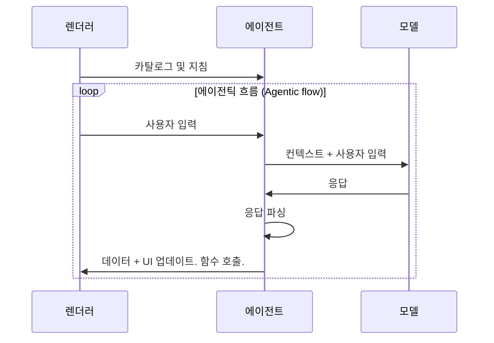
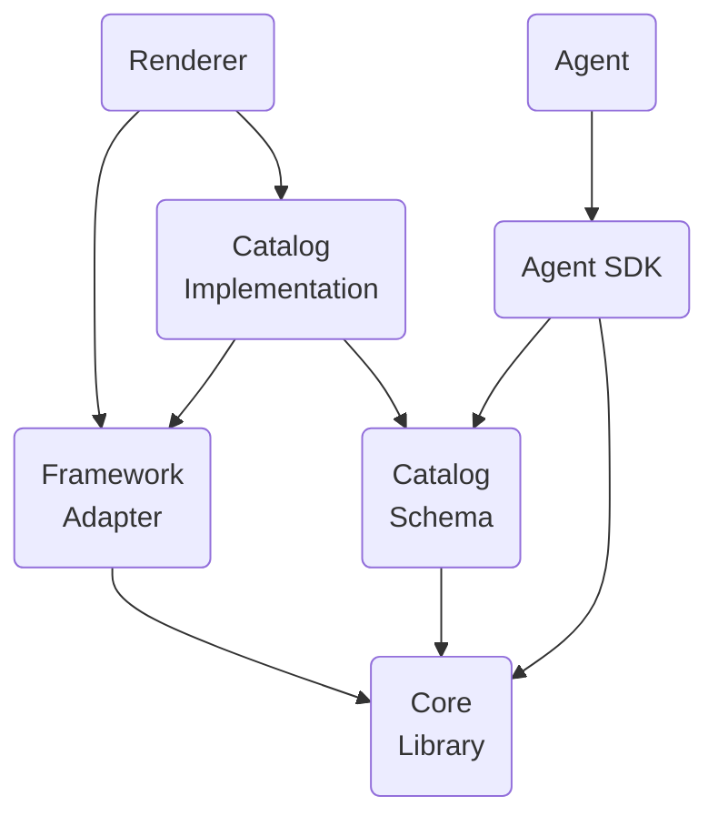

# 용어집

**렌더러와 에이전트 사이의 A2UI 프로토콜:**

A2UI 프로토콜은 **에이전트**와 **렌더러** 사이의 대화를 정의합니다:

1. **렌더러**는 자신의 **UI 기능**을 A2UI 카탈로그 집합으로, 이를 사용하는 방법에 대한 **지침**과 함께 전송합니다.
2. 그런 다음 **에이전트**는 다음 루프를 반복합니다:
    - 전달받은 카탈로그를 바탕으로 렌더링할 **UI**와 호출할 **함수**를 전송합니다
    - 렌더러로부터 **사용자 입력**을 받습니다
    - UI에 표시되는 **데이터**를 업데이트합니다

**에이전트와 모델:**

렌더러에 보낼 응답을 생성하기 위해 에이전트는 모델에 요청을 보냅니다. 모델은 다음 중 하나일 수 있습니다:

- 대부분의 경우 원격 또는 로컬 LLM
- 더 복잡한 오케스트레이션에서의 다른 에이전트
- 주로 테스트 목적으로 사용되는 결정론적(deterministic) 엔진

**상호작용 개요:**

**A2UI SDK:**

A2UI 팀은 여러 언어와 프레임워크를 위해 두 가지 SDK를 제공합니다:

- **Agent SDK**: 렌더러 및 모델과의 상호작용에서 에이전트 측 구성을 담당합니다.
- **Framework adapter SDK (일명 renderer SDK)**: 에이전트와의 상호작용에서 렌더러 측 구성을 담당하고 들어오는 메시지를 처리합니다.

**이 용어집의 구성:**

아래 용어들은 세 가지 범주로 나뉩니다:

- **A2UI 프로토콜 용어**: 렌더러와 에이전트 간의 상호작용과 관련된 용어입니다.
- **A2UI 에이전트 용어**: 에이전트 아키텍처 및 Agent SDK와 관련된 용어입니다.
- **생성형 UI 용어**: 일반적인 생성형 UI 개념과 관련된 용어입니다.

## A2UI 프로토콜 용어

A2UI 프로토콜에서 요구되는 용어입니다.

### A2UI 에이전트와 A2UI 렌더러

이 프로토콜은 **AI 기반 에이전트**를 위해 설계되었지만, 결정론적 에이전트와도 함께 동작합니다. 예를 들어 에이전트가 미리 준비된 A2UI UI를 반환할 수도 있습니다.

에이전트가 상태를 유지하지 않거나(stateless) 카탈로그 보존을 보장하지 않는 경우, 렌더러는 모든 메시지에 카탈로그를 함께 전송해야 합니다.

일부 에이전트는 사전에 정의된 카탈로그를 사용하므로, 렌더러는 해당 카탈로그를 지원하거나 어댑터를 사용해야 합니다.

### GenUI 컴포넌트

에이전트가 사용할 수 있도록 허용된 UI 컴포넌트입니다. 예: date picker, carousel, button, hotel selector.

### Catalog (카탈로그)

1. 항목별로 정리된 렌더러 기능입니다:
    - 에이전트가 UI를 생성할 때 사용할 수 있는 컴포넌트 목록
    - 렌더러 또는 에이전트가 호출할 수 있는 함수 목록
    - 스타일과 테마
2. 해당 기능들을 사용하는 방법에 대한 설명입니다.

사용 사례에 따라 카탈로그 컴포넌트는 도메인에 덜 특화되거나 더 많이 특화될 수 있습니다:

- **덜 특화된 경우**:

    버튼, 라벨, 행, 열, 옵션 선택기 같은 기본 UI 프리미티브입니다.

- **더 특화된 경우**:

    `HotelCheckout`이나 `FlightSelector` 같은 컴포넌트입니다.

### Basic catalog (기본 카탈로그)

A2UI를 빠르게 시작할 수 있도록 A2UI 팀이 유지 관리하는 카탈로그입니다.

[기본 카탈로그(Basic Catalog)](../../../specification/v0_9_1/catalogs/basic/catalog.json)를 참고하세요.

### Catalog transformer (카탈로그 트랜스포머)

시스템 프롬프트 지시문이 생성되거나 페이로드 검증 스키마가 컴파일되기 전에, 원본 **카탈로그**를 필터링·조정·변형하는 규칙 집합입니다.

#### 카탈로그 트랜스포머가 필요한 이유

카탈로그는 렌더러가 지원하는 모든 컴포넌트와 함수를 명시하지만, 에이전트는 종종 이를 잘라내거나 제한해야 합니다:

- **컨텍스트 윈도 최적화**: 카탈로그는 수십 개의 컴포넌트와 함수를 정의할 수 있습니다. 모든 JSON 스키마를 모델의 시스템 프롬프트에 주입하면 컨텍스트 윈도 토큰을 소모하고, 프롬프트 지연 시간이 늘어나며, 추론 비용이 높아집니다. 가지치기(pruning) 트랜스포머는 에이전트의 작업에 필요한 컴포넌트만 남깁니다.
- **기능 가드레일**: 일부 워크플로나 보안 역할에서는 상호작용 기능을 제한해야 합니다. 예를 들어 게스트 모드에서는 표시용 카드와 텍스트는 허용하되 폼 입력이나 관리자용 컴포넌트는 허용하지 않을 수 있습니다.
- **모델 시그니처 축소**: 함수 규칙과 검증 항목을 잘라내면 소형 모델을 위한 간결한 프롬프트 지침을 만들 수 있습니다.

#### 카탈로그 트랜스포머 예시

- `ComponentPruningTransformer`: 허용된 컴포넌트 이름 목록을 기준으로 카탈로그를 필터링하는 유틸리티 클래스입니다.

- `FunctionPruningTransformer`: 허용된 함수 이름 목록을 기준으로 카탈로그를 필터링하는 유틸리티 클래스입니다.

### Capabilities object (기능 객체)

사용 가능한 카탈로그의 집합입니다. 에이전트나 렌더러는 이 집합을 통해 자신이 지원하는 항목을 광고(advertise)하므로, 상대방은 무엇을 전송해도 되는지 알 수 있습니다.

예를 들어 렌더러가 Basic, Hotels, Flights 카탈로그를 지원한다면 자신의 기능 객체에 이를 광고합니다.

기능 객체는 [A2UI 메시지](#a2ui-message)가 아니라 전송 계층 메타데이터 또는 초기화 페이로드를 통해 교환됩니다. 정확한 위치는 전송 방식(transport)에 따라 다릅니다.

이 객체는 프로토콜의 이전 버전에서는 다른 이름으로 불렸습니다: v0.9 및 v0.9.1에서는 클라이언트 및 서버 기능(client and server capabilities)이라고 부르며, v0.8에서는 클라이언트 측 스키마만 정의합니다.

### Surface (서피스)

A2UI 에이전트가 구성하고 A2UI 렌더러가 관리하는 UI 영역으로, 여러 컴포넌트로 이루어집니다. 서피스는 중첩될 수 없습니다.

### A2UI message (A2UI 메시지)

에이전트와 렌더러 사이의 메시지입니다.

프로토콜이 스트리밍을 지원하므로, 메시지는 완료된 상태(완전히 전달됨)이거나 미완료 상태(부분적으로 전달됨)일 수 있습니다. 완료된 메시지는 정상 완료(성공적으로 전달됨)되었거나 중단된 상태(기술적 문제로 전달이 멈춤) 중 하나입니다.

[데이터 흐름 가이드](data-flow.md)를 참고하세요.

### Agent turn (에이전트 턴)

에이전트가 사용자 입력을 기다리기 시작하기 전에 전송하는 메시지 집합입니다.

### Data model (데이터 모델)

렌더러와 에이전트가 공유하고 양쪽 모두 업데이트할 수 있는 관찰 가능한(observable) 계층적 JSON 유사 객체입니다. 각 서피스는 자체 데이터 모델을 가집니다.

컴포넌트는 데이터 모델의 노드에 바인딩되어 해당 값이 변경될 때 자동으로 업데이트될 수 있습니다.

데이터 모델은 양방향 동기화를 제공합니다: 사용자 상호작용을 상태 객체로 캡처하여 에이전트로 전송하고, 에이전트가 데이터 업데이트를 다시 UI로 푸시할 수 있게 해 줍니다.

[데이터 바인딩 가이드](data-binding.md)를 참고하세요.

### Data reference (데이터 참조)

컴포넌트 정의에서 데이터 모델의 경로 또는 값으로 해석되는 데이터 요소에 대한 참조입니다.

[기본 카탈로그의 예시](../../../specification/v0_9/catalogs/basic/catalog.json#L23)를 참고하세요.

### Function (함수) 

선언된 인자 시그니처와 반환 타입을 가진, 이름이 지정된 카탈로그 정의 연산입니다. 함수는 에이전트와 렌더러 사이에 원시 실행 코드를 주고받지 않고도 로직을 실행합니다.

함수는 카탈로그에 정의되며 렌더러 또는 에이전트 중 한쪽에서 실행될 수 있습니다:

- **렌더러 함수 (Renderer function)**: **렌더러**에서 실행되는 함수입니다. 렌더러 함수는 값 포매팅, 입력 필드 검증, 내비게이션, 로컬 UI 상태 제어와 같은 클라이언트 측 작업을 처리합니다. 또한 에이전트가 렌더러에 함수 실행을 요청할 수도 있습니다(예: 알림 표시 또는 기기 피드백 트리거).
- **에이전트 함수 (Agent function)**: **에이전트**에서 실행되는 함수입니다. UI에 서버 측 로직(예: 재고 확인, 데이터베이스 조회, 자격 증명 확인)이 필요한 경우, 렌더러가 에이전트에 함수 실행 및 결과 반환을 요청합니다.

A2UI 함수는 LLM 도구(tool)와 다릅니다:

| 항목         | A2UI 함수                                                                | LLM 도구 호출                                   |
| ------------ | ------------------------------------------------------------------------ | ----------------------------------------------- |
| 실행 주체    | A2UI 렌더러(렌더러 함수) 또는 에이전트(에이전트 함수).                   | UI 외부의 모델 호스트 또는 에이전트 환경.       |
| 실행 시점    | UI 렌더링 중, 사용자 상호작용 시, 또는 턴 사이의 요청으로 실행.          | 모델 응답 생성 전 또는 생성 도중.               |
| 목적         | UI 로직: 검증, 포매팅, 클라이언트 액션 또는 앱 작업.                     | 모델 추론, 웹 검색, 데이터베이스 조회.          |
| 정의 위치    | 인자 및 반환 시그니처와 함께 A2UI 카탈로그에 선언됨.                     | 모델에 전달되는 도구 정의(tool definition)에 선언됨. |
| 상태 접근    | 서피스 데이터 컨텍스트, 로컬 UI 상태 또는 카탈로그 메서드로 범위가 지정됨. | 외부 도구, API 및 서비스로 범위가 지정됨.       |

에이전트와 렌더러 사이에서 함수가 어떻게 라우팅되고 실행되는지에 대한 자세한 내용은 [프로토콜 명세의 A2UI 함수 섹션](../specification/v1.0-a2ui.md#functions-in-a2ui-content-execution)을 참고하세요.

### Function call (함수 호출)

인자 집합을 사용하여 카탈로그 함수를 호출하는 것입니다.

함수 호출은 여러 맥락에서 나타납니다:

- **동적 값 바인딩 (Dynamic value bindings)**: 렌더러가 컴포넌트 속성 값을 동적으로 계산하기 위해 렌더러 함수를 호출합니다(예: 날짜 또는 통화 포매팅).
- **검증 규칙 (Validation rules)**: 렌더러가 제출 전에 사용자 입력을 검증하기 위해 렌더러 함수를 호출합니다.
- **컴포넌트 상호작용 트리거 (Component interaction triggers)**: 사용자가 컴포넌트와 상호작용할 때 렌더러가 렌더러 함수를 호출합니다(예: URL 열기).
- **원격 프로시저 호출 (RPC)**: 에이전트가 렌더러에 렌더러 함수 실행을 요청하거나, 렌더러가 에이전트에 에이전트 함수 실행을 요청합니다.

대상 함수가 호출자의 환경에 구현되어 있으면 함수 호출은 로컬에서 실행됩니다. 함수가 에이전트-렌더러 경계의 반대편에 있는 경우 호출은 프로토콜을 통해 전달됩니다. 에이전트와 렌더러가 동일한 프로세스 내에서 실행되는 아키텍처(예: 독립 실행형 데스크톱 애플리케이션)에서는 네트워크 전송 없이 프로세스 내에서 바로 실행될 수 있습니다.

### Action (액션)

사용자가 UI 컴포넌트와 상호작용할 때 트리거되어 렌더러에서 에이전트로 디스패치되는 이벤트입니다.

액션은 에이전트에 상호작용(예: 버튼 클릭 또는 옵션 선택)이 발생했음을 알립니다. 액션 이름, 렌더러 데이터 모델에서 추출한 관련 값, 그리고 액션에 대한 선택적 설명과 함께 사용자의 의도를 전달합니다.

액션은 대화 턴이나 비즈니스 로직을 진행하기 위해 에이전트로 다시 전달되는 사용자의 의도를 나타냅니다. 반면, 컴포넌트 상호작용이 에이전트에 알리지 않고 직접 동작을 트리거하는 경우(예: URL 열기 또는 클라이언트 측 계산 실행)에는 액션을 디스패치하는 대신 [함수 호출](#function-call)을 수행합니다.

[액션에 대한 상세 가이드](actions.md)를 참고하세요.

## A2UI 에이전트 용어

에이전트 아키텍처와 Agent SDK를 설명하는 데 사용되는 용어입니다.

### A2UI tag (A2UI 태그)

모델이 에이전트로 보내는 메시지에서, 모델의 텍스트 출력 내부에 있는 A2UI 페이로드 블록의 경계를 표시하는 `<a2ui-json>` 또는 `<a2ui>` 같은 구분자 태그입니다.

단일 모델 턴에는 대화형 텍스트와 구조화된 UI 블록이 함께 섞여 있을 수 있으므로, A2UI 태그는 각 UI 블록이 시작하고 끝나는 위치를 표시합니다.

### Inference format (추론 포맷)

모델이 에이전트로 보내는 메시지에 포함된 구조화된 UI 블록의 포맷입니다. 예를 들어 JSON, [Express DSL 문법](https://github.com/a2ui-project/a2ui/tree/main/python/a2ui_agent/src/a2ui/inference_formats/experimental/express), 또는 Elemental HTML 태그가 있습니다.

### 모델-에이전트 응답 파싱 단계

**Tag unwrapping (태그 언래핑):**

응답 파싱의 첫 번째 단계(`unwrap`)로, 파서가 모델 응답에서 여는 **A2UI 태그**와 닫는 **A2UI 태그**를 스캔하고 대화형 텍스트(예: _"요약 결과는 다음과 같습니다:"_)를 태그로 감싸인 원본 UI 블록과 분리합니다.

**Compilation (컴파일):**

응답 파싱의 두 번째 단계(`compile`)로, 언래핑 과정에서 추출된 원본 UI 블록(표준 JSON, Express DSL 문법, 또는 Elemental HTML 태그)을 파싱 및 디컴파일하여 `createSurface`, `updateDataModel` 같은 표준 A2UI 프로토콜 페이로드로 변환합니다.

### 에이전트 아키텍처

A2UI 에이전트는 여러 방식으로 구축할 수 있습니다:

- **동일 프로세스 또는 서버 측**:

    에이전트와 렌더러가 클라이언트 측 애플리케이션의 단일 프로세스 안에 함께 존재할 수 있습니다. 예: 데스크톱 Flutter 애플리케이션.

    또는 렌더러는 UI를 표시하는 기기에 있고, 에이전트는 다른 기기(서버)에 있을 수 있습니다.

- **오케스트레이터 에이전트**:

    중앙 오케스트레이터가 사용자와 여러 전문 서브 에이전트 사이의 상호작용을 관리합니다. 오케스트레이터는 동일 프로세스에 있을 수도 있고 서버에 있을 수도 있습니다.

- **Pulling / pushing**:

    에이전트는 렌더러로부터 메시지와 요청을 기다릴 수도 있고, 렌더러로 푸시할 수도 있습니다.

- **Stateful / stateless**:

    에이전트는 상태를 보존할 수도 있고 상태를 유지하지 않을 수도(stateless) 있습니다.

- **다른 프로토콜과 혼합**:

    A2UI는 다른 프로토콜과 조합하여 사용할 수 있습니다. 예를 들어 에이전트가 MCP 및/또는 A2A 서버일 수 있습니다.

- **기타**:

    위 선택지들의 커스텀 변형도 가능합니다.

### 권장 코드 구성

에이전트와 렌더러 기능은 개별적으로 개발하고 재사용할 수 있는 계층들로 구성됩니다:

- **Core library (코어 라이브러리)**:

    카탈로그를 기술하고 에이전트와 상호작용하는 데 필요한 프리미티브 집합입니다.

    예를 들어 [JavaScript 웹 코어 라이브러리](../../../typescript/web_core/README.md)를 참고하세요.

- **Catalog schema (카탈로그 스키마)**:

    JSON 형태의 카탈로그 정의입니다.

    예를 들어 [기본 카탈로그 스키마](../../../specification/v0_9_1/catalogs/basic/catalog.json)를 참고하세요.

- **Agent SDK**:

    모델 및 렌더러와 에이전트의 상호작용을 구현하는 코드입니다.

- **Framework adapter (또는 renderer SDK)**:

    구체적인 프레임워크에서 에이전트의 지침을 실행하는 코드입니다. 예:
    - JavaScript 코어와 카탈로그는 Angular, Electron, React, Lit 프레임워크에 맞게 어댑팅될 수 있습니다.
    - Dart 코어와 카탈로그는 Flutter 및 Jaspr 프레임워크에 맞게 어댑팅될 수 있습니다.

    [Angular 어댑터](../../../renderers/angular/README.md)를 참고하세요.

- **Catalog implementation (카탈로그 구현)**:

    특정 프레임워크에 대한 카탈로그 스키마의 구현체입니다.

    예:
    - [기본 카탈로그의 Angular 구현](../../../renderers/angular/src/v0_9/catalog/basic)을 참고하세요.

## 생성형 UI 용어

A2UI 프로토콜에서 필수로 요구하지는 않지만 생성형 UI 맥락에서 흔히 사용되는 용어입니다.

### 알려진 GenUI 패턴

- **Chat (채팅)**:

    생성된 UI 조각들이 시간순으로 정렬되어 세로 스크롤 영역에 사용자 입력과 섞여 하나씩 나타납니다.

- **Canvas (캔버스)**:

    에이전트와 협업하기 위한 공간입니다.

- **Dashboard (대시보드)**:

    생성된 UI 조각들이 시간순이 아니라 의미에 따라 구성되며, 사용자가 기대하는 위치에 고정(pinned)된 상태로 유지됩니다.

- **Wizard (위저드)**:

    특정 작업에 필요한 정보를 수집하기 위해 생성된 UI 조각들이 하나씩 순서대로 표시됩니다.

### NoAI 정보

신용카드 세부 정보처럼 **AI가 접근할 수 없는 정보**로 분류된 정보입니다.

어떤 정보가 AI에 의해 접근되어서는 안 되는지는 애플리케이션 소유자가 결정하며, 그 답은 **맥락마다 다릅니다**. 예를 들어 어떤 제품에서는 병력이 절대 AI로 전달되어서는 안 되지만, 다른 제품에서는 AI가 진단을 돕기 위해 병력에 의존합니다.

이 용어는 GenUI 맥락에서 중요한데, 최종 사용자가 자신의 입력 중 어떤 것이 AI로 전달될 수 있고 어떤 것이 전달될 수 없는지 **명확히 확인하기를** 원하기 때문입니다.
