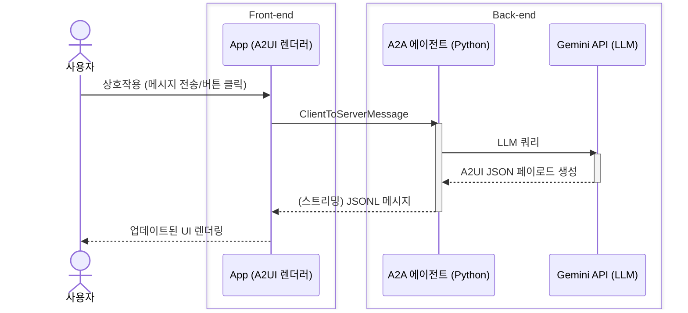

# 퀵스타트: 5분 만에 A2UI 실행하기

레스토랑 찾기 데모를 실행해 A2UI를 직접 체험해 보세요. 이 가이드를 따라가면 5분 안에 에이전트가 생성한 UI를 경험할 수 있습니다.

## 만들게 될 것

이 퀵스타트를 끝내면 다음을 갖게 됩니다:

- A2UI 렌더러(Lit 또는 Flutter)가 동작하는 앱
- 동적 UI를 생성하는 Gemini 기반 에이전트
- 폼 생성, 시간 선택, 확인 흐름을 포함한 대화형 레스토랑 찾기
- A2UI 메시지가 에이전트에서 UI까지 흘러가는 방식에 대한 이해

## 사전 준비

시작하기 전에 사용할 클라이언트 프레임워크를 선택하세요:

=== "Lit"

    - **Node.js** (v18 이상, [Corepack](https://nodejs.org/api/corepack.html) 활성화 필요) — [다운로드](https://nodejs.org/)

=== "Flutter"

    - **Flutter SDK** — [설치 안내](https://docs.flutter.dev/install)

**공통 사전 준비:**

- **uv** (Python 패키지 관리자) — [설치 안내](https://docs.astral.sh/uv/getting-started/installation/) (Python 에이전트 백엔드 실행에 사용)
- **Gemini API 키** — [Google AI Studio에서 무료로 받기](https://aistudio.google.com/apikey)

> [!WARNING]
> **보안 알림**
>
> 이 데모는 Gemini를 사용해 A2UI 응답을 생성하는 A2A 에이전트를 실행합니다. 에이전트는 여러분의 API 키에 접근하고 Google Gemini API에 요청을 보냅니다. 프로덕션 환경에서 실행하기 전에 항상 에이전트 코드를 검토하세요.

## 1단계: 저장소 복제

```bash
git clone https://github.com/a2ui-project/a2ui.git
cd a2ui
```

## 2단계: API 키 설정

Gemini API 키를 환경 변수로 내보냅니다:

```bash
export GEMINI_API_KEY="your_gemini_api_key_here"
```

## 3단계: 에이전트 및 클라이언트 실행

=== "Lit"

    클라이언트 애플리케이션 소스 코드는 `samples/client/lit/shell`에 있습니다. 데모를 실행하려면 상위 samples 디렉터리로 이동하세요:

    ```bash
    cd samples/client/lit

    # Corepack 활성화 (macOS Homebrew 사용자는 아래 팁 참고)
    corepack enable

    yarn install
    yarn demo:restaurant
    ```

    ??? note "에이전트와 클라이언트를 별도로 실행하기"
        `demo:restaurant` 명령어는 A2A 에이전트와 웹 클라이언트를 모두 자동으로 실행합니다. 이는 다음 명령과 동일합니다:

        **1. 에이전트 실행:**

        ```bash
        cd samples/agent/adk/restaurant_finder
        uv run .
        ```

        **2. 클라이언트 실행:**

        ```bash
        cd samples/client/lit/shell
        yarn dev
        ```

    > [!INFO]
    > **패키지 관리자 안내:**
    >
    > A2UI 저장소는 자체 개발에 `yarn`을 사용하지만, A2UI를 **사용**하기 위해 `yarn`이 필수는 아닙니다. 여러분의 프로젝트에서는 선호하는 패키지 관리자(예: `npm`, `pnpm`)를 자유롭게 사용할 수 있습니다.

=== "Flutter"

    **1. 에이전트 실행:**

    첫 번째 터미널에서 Python 에이전트 백엔드를 시작합니다:

    ```bash
    cd samples/agent/adk/restaurant_finder
    uv run .
    ```

    **2. 클라이언트 실행:**

    두 번째 터미널에서 Flutter 웹 애플리케이션을 실행합니다:

    ```bash
    cd samples/client/flutter/restaurant_finder/app
    flutter run -d chrome
    ```

> [!TIP]
> **데모 실행 중**
>
> 모든 것이 정상적으로 동작하면 데모 앱이 표시됩니다. 이제 에이전트가 UI를 생성할 준비가 되었습니다!

## 4단계: 직접 해 보기

웹 앱에서 아래 프롬프트를 시도해 보세요:

1. **"Book a table for 2" (2명 예약해 줘)** - 에이전트가 예약 양식을 생성하는 것을 확인합니다
2. **"Find Italian restaurants near me" (근처의 이탈리안 레스토랑 찾아줘)** - 동적 검색 결과를 확인합니다
3. **"What are your hours?" (영업시간이 어떻게 돼?)** - 의도에 따라 달라지는 UI 레이아웃을 살펴봅니다

데모 애플리케이션은 에이전트의 각 응답에 따라 화면을 업데이트하며, 모든 UI는 Gemini LLM에 의해 완전히 동적으로 생성됩니다. **결과 화면(레스토랑 목록, 예약 흐름, 예약 확인 등)은 앱 소스 코드에 하드코딩되어 있지 않습니다.**

---

## 어떻게 동작하나요?

이 데모 앱이 어떻게 구성되어 있는지, 그리고 A2UI로 유사한 애플리케이션을 어떻게 빌드할 수 있는지 자세히 살펴보겠습니다.

### 상호작용 시퀀스 다이어그램



1. **사용자가 상호작용**: 앱과 상호작용합니다 (메시지 전송, 버튼 클릭 등).
2. **A2A 에이전트가 수신**: 대화 내용을 받아 Gemini로 전달합니다.
3. **Gemini가 A2UI JSON 생성**: UI를 기술하는 메시지를 생성합니다.
4. **A2A 에이전트가 스트리밍**: 이 메시지들을 앱으로 스트리밍합니다.
5. **A2UI 렌더러가 변환**: 메시지를 네이티브 UI 컴포넌트로 변환합니다.
6. **앱 UI 업데이트**: 렌더링된 최신 화면이 사용자에게 표시됩니다.

### A2UI JSON 페이로드

에이전트가 무엇을 반환하는지 살펴보겠습니다. 아래는 단순화된 JSON 메시지 예시입니다:

=== "v0.9"

    **서피스 생성:**

    ```json
    { "version": "v0.9.1",
      "createSurface": {
        "surfaceId": "main",
        "catalogId": "https://a2ui.org/specification/v0_9_1/catalogs/basic/catalog.json"
      }}
    ```

    **UI 정의:**

    ```json
    { "version": "v0.9.1",
      "updateComponents": {
        "surfaceId": "main",
        "components": [
          {"id": "header", "component": "Text", "text": "# Book Your Table", "variant": "h1"},
          {"id": "date-picker", "component": "DateTimeInput", "label": "Select Date", "value": {"path": "/reservation/date"}, "enableDate": true},
          {"id": "submit-text", "component": "Text", "text": "Confirm Reservation"},
          {"id": "submit-btn", "component": "Button", "child": "submit-text", "variant": "primary", "action": {"event": {"name": "confirm_booking"}}}
        ]
      }}
    ```

    **데이터 채우기:**

    ```json
    { "version": "v0.9.1",
      "updateDataModel": {
        "surfaceId": "main",
        "path": "/reservation",
        "value": {"date": "2025-12-15", "time": "19:00", "guests": 2}
      }}
    ```

=== "Legacy (v0.8)"

    **UI 정의:**

    ```json
    {"surfaceUpdate": {"surfaceId": "main", "components": [
      {"id": "header", "component": {"Text": {"text": {"literalString": "Book Your Table"}, "usageHint": "h1"}}},
      {"id": "date-picker", "component": {"DateTimeInput": {"label": {"literalString": "Select Date"}, "value": {"path": "/reservation/date"}, "enableDate": true}}},
      {"id": "submit-text", "component": {"Text": {"text": {"literalString": "Confirm Reservation"}}}},
      {"id": "submit-btn", "component": {"Button": {"child": "submit-text", "action": {"name": "confirm_booking"}}}}
    ]}}
    ```

    **데이터 채우기:**

    ```json
    {"dataModelUpdate": {"surfaceId": "main", "contents": [
      {"key": "reservation", "valueMap": [
        {"key": "date", "valueString": "2025-12-15"},
        {"key": "time", "valueString": "19:00"},
        {"key": "guests", "valueInt": 2}
      ]}
    ]}}
    ```

    **렌더링 시작 신호:**

    ```json
    {"beginRendering": {"surfaceId": "main", "root": "header"}}
    ```

    참고: v0.8에서는 `createSurface` 대신 `beginRendering`이었으며, 컴포넌트가 중첩되어 응답에 포함되었고, 데이터 모델은 평평한 JSON 대신 인접 리스트(adjacency list)를 사용했습니다.

> [!TIP]
> **그냥 JSON입니다**
>
> 이 구조가 얼마나 읽기 쉽고 체계적인지 보이시나요? LLM은 이를 쉽게 생성할 수 있으며, **코드 실행 없이** 안전하게 전송 및 렌더링할 수 있습니다.

### 소스 코드 살펴보기

실제 코드가 어떻게 생겼는지 확인하고 싶다면 다음 디렉터리를 살펴보세요:

- **에이전트 코드**: `samples/agent/adk/restaurant_finder/` — Python A2A 에이전트

=== "Lit"

    - **클라이언트 코드**: `samples/client/lit/` — A2UI 렌더러가 포함된 Lit 웹 클라이언트
    - **A2UI 렌더러**: `renderers/lit/` (Lit) 및 `renderers/web_core/` (프레임워크 중립 코어)

=== "Flutter"

    - **클라이언트 코드**: `samples/client/flutter/` — A2UI 렌더러가 포함된 Flutter 웹 클라이언트
    - **A2UI 렌더러**: `dart/a2ui_flutter/` (Flutter)

각 디렉터리에는 자세한 문서가 담긴 자체 README가 있습니다.

---

## 문제 해결

=== "Lit"

    ### 포트가 이미 사용 중인 경우

    포트 5173이 이미 사용 중이면 개발 서버가 자동으로 다음 사용 가능한 포트를 시도합니다. 실제 URL은 터미널 출력을 확인하세요.

    ### Corepack 및 Homebrew 이슈

    독립형 패키지 관리자가 이미 설치되어 있다면, Corepack이 프로젝트별로 버전을 관리할 수 있도록 설치 전에 충돌을 해제하세요:

    > ```bash
    > $ brew unlink yarn pnpm
    > $ brew install corepack
    > $ corepack enable
    > ```

=== "Flutter"

    <!--- Flutter 데모 문제 해결 안내가 여기에 추가될 수 있습니다. --->

### API 키 문제

API 키가 없다는 오류가 보이면:

1. 키가 내보내졌는지 확인합니다: `echo $GEMINI_API_KEY`
2. [Google AI Studio](https://aistudio.google.com/apikey)에서 발급받은 유효한 Gemini API 키인지 확인합니다
3. 다시 설정해 봅니다: `export GEMINI_API_KEY="your_key"`

### 시작 시 연결 오류

브라우저가 열릴 때 `ERR_CONNECTION_REFUSED` 오류가 나타나더라도 **걱정하지 마세요** — 이는 알려진 레이스 컨디션입니다. 웹 앱이 Python 에이전트 백엔드보다 먼저 시작될 수 있습니다. 몇 초 정도 기다렸다가 페이지를 새로고침하세요.

### Python / uv 문제

데모 에이전트는 실행에 [uv](https://docs.astral.sh/uv/)가 필요합니다. `uv: command not found`가 표시되면:

```bash
# uv 설치
curl -LsSf https://astral.sh/uv/install.sh | sh

# 확인
uv --version
```

다른 Python 오류가 발생하면:

```bash
# Python 3.10+ 사용 가능한지 확인
python3 --version

# 에이전트를 수동으로 직접 실행
cd samples/agent/adk/restaurant_finder
uv run .
```

### 여전히 문제가 해결되지 않나요?

- [GitHub Issues](https://github.com/a2ui-project/a2ui/issues)를 확인하세요
- 샘플 README.md ([Lit](../../samples/client/lit) 또는 [Flutter](../../samples/client/flutter))를 검토하세요
- 커뮤니티 토론에 참여하세요

---

## 더 많은 데모 살펴보기

=== "Lit"

    ### Lit 컴포넌트 갤러리 (에이전트 불필요)

    제공되는 모든 기본 카탈로그(Basic Catalog) 컴포넌트를 확인해 보세요:

    새로 clone한 저장소에서 갤러리를 실행하는 경우, 먼저 갤러리와 그 워크스페이스 의존성을 빌드하세요:

    ```bash
    cd renderers/lit/a2ui_explorer
    yarn build
    ```

    갤러리를 시작합니다:

    ```bash
    yarn dev
    ```

    이 클라이언트 전용 데모는 표준 컴포넌트(Card, Button, TextField, Timeline 등)를 라이브 예시와 코드 샘플과 함께 보여줍니다.

=== "Flutter"

    <!--- Flutter 전용 클라이언트 샘플이 여기에 추가될 수 있습니다. --->

### 다른 언어와 프레임워크

A2UI는 `samples/client` 디렉터리에서 다른 인기 프레임워크용 샘플도 제공합니다:

- **Angular**: `samples/client/angular`
- **Flutter**: `samples/client/flutter`
- **Lit**: `samples/client/lit`
- **React**: `samples/client/react`

사용 가능한 모든 클라이언트 구현을 확인하려면 [samples/client](../../samples/client) 디렉터리를 살펴보세요.

---

## 다음 단계

**축하합니다!** 첫 번째 A2UI 애플리케이션을 성공적으로 실행했습니다. 이제 AI 에이전트가 안전하고 선언적인 JSON 메시지만으로 웹 애플리케이션에 네이티브하게 렌더링되는 풍부하고 대화형인 UI를 생성하는 과정을 확인했습니다.

자세한 내용을 알아보려면 다음 링크를 확인하세요:

- **[핵심 개념 배우기](concepts/overview.md)**: 서피스, 컴포넌트, 데이터 바인딩 이해하기
- **[에이전트 빌드하기](guides/agent-development.md)**: A2UI 응답을 생성하는 에이전트 만들기
- **[나만의 클라이언트 설정하기](guides/client-setup.md)**: 자신의 앱에 A2UI 통합하기
- **[나만의 카탈로그 정의하기](guides/defining-your-own-catalog.md)**: 기본 카탈로그를 넘어 앱 생성에 사용되는 UI 엘리먼트 직접 제어하기
- **[기존 에이전트 앱 활용하기](guides/a2ui-with-any-agent-framework.md)**: CopilotKit + AG-UI를 통해 ADK, LangGraph, CrewAI, Mastra 또는 커스텀 서비스에 A2UI 추가하기
- **[프로토콜 살펴보기](reference/messages.md)**: 기술 사양 자세히 보기
